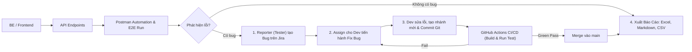

# 🚲 BÁO CÁO ĐỒ ÁN MÔN HỌC: KIỂM THỬ PHẦN MỀM (SOFTWARE TESTING)

> **Cơ sở đào tạo:** Trường Đại học Giao thông Vận tải TP.HCM (UTH)  
> **Khoa:** Công nghệ Thông tin – Bộ môn: Kỹ thuật Phần mềm & Kiểm thử Chất lượng  
> **Dự án kiểm thử:** Website Mua Bán Xe Đạp Thể Thao Cũ (C2C Bike Marketplace Platform)  
> **Repository:** [https://github.com/hoangnam230505/Websitemuabanxedap](https://github.com/hoangnam230505/Websitemuabanxedap)  
> **CI/CD Pipeline Status:** 

---

## 👥 1. BẢNG PHÂN CÔNG THÀNH VIÊN & NHIỆM VỤ DỰ ÁN

Hệ thống được theo dõi và quản lý công việc thông qua **Jira Software (Project Key: `KTWXD`)** và **GitHub Actions**.

| STT | Họ và Tên | Mã Sinh Viên (MSSV) | Vai Trò | Nhiệm Vụ Chính Trong Dự Án Kiểm Thử | Jira Ticket Phụ Trách |
|:---:|:---|:---:|:---|:---|:---:|
| 1 | **Hoàng Nam Nguyễn** | *Team Leader* | QA Lead & Test Automation | - Trưởng nhóm điều phối dự án kiểm thử.<br>- Xây dựng kịch bản kiểm thử tự động giao diện E2E bằng **CodeceptJS + Playwright**.<br>- Thiết kế kịch bản luồng tương tác người dùng: Đăng nhập, Catalog xe, Giỏ hàng. | `KTWXD-1`<br>`KTWXD-5` |
| 2 | **Lê Thành Nhật** | **060205006183**<br>*(GitHub: ltnhat0313)* | Core QA & CI/CD Specialist | - Tích hợp phân tích mã tĩnh bảo mật với **JetBrains Qodana** (`qodana.yaml`).<br>- Thiết lập quy trình tự động hóa **GitHub Actions CI/CD Pipeline** đa tầng (`.github/workflows/ci.yml`).<br>- Thiết kế bộ **108 Test Cases toàn diện 7 chương** (BVA, Phân vùng tương đương, Bảng quyết định, State Transition, v.v.) xuất ra Excel, Word, CSV.<br>- Xây dựng kịch bản kiểm thử hộp trắng (**White-box CFG Basis Path Testing**) đạt 100% Branch Coverage (`tests/whitebox_test.js`).<br>- Xây dựng bộ tự động hóa kiểm thử API bằng **Postman Collection** (28/28 assertions PASSED). | `KTWXD-2`<br>`KTWXD-6`<br>`KTWXD-8` |
| 3 | **Nguyễn Thiên Giang** | *Member* | DevOps & Deployment QA | - Đóng gói container hóa toàn bộ hệ thống bằng **Docker & Docker Compose**.<br>- Quản lý version build, tự động hóa build image và push lên **Docker Hub** (`latest`, `v1.0.0`). | `KTWXD-3`<br>`KTWXD-7` |
| 4 | **Tuấn Trần** | *Member* | Automation QA Support | - Hỗ trợ thiết lập kịch bản kiểm thử hồi quy (Regression Testing).<br>- Giám sát thực thi kiểm thử và thu thập log kết quả trong pipeline. | `KTWXD-4` |

---

## 🛠️ 2. BỐN (4) CÔNG NGHỆ TRỌNG TÂM TRIỂN KHAI

Tuân thủ chặt chẽ yêu cầu chuẩn hóa từ Giảng viên (Feedback trên ELearning môn học), dự án áp dụng trọn vẹn bộ công cụ kiểm thử và CI/CD hiện đại:

```
+-----------------------------------------------------------------------------------+
|                           HỆ THỐNG KIỂM THỬ TỰ ĐỘNG                               |
+-----------------------------------------------------------------------------------+
|  [1. Qodana]       --> Phân tích tĩnh, rà soát lỗ hổng bảo mật & code smells       |
|  [2. CodeceptJS]   --> Kiểm thử tự động E2E hành vi người dùng (Playwright engine) |
|  [3. GitHub Action]--> Pipeline CI/CD tự động hóa thực thi Test & Build            |
|  [4. Docker Hub]   --> Đóng gói container, quản lý version build độc lập          |
+-----------------------------------------------------------------------------------+
```

### 1. Phân tích mã tĩnh với JetBrains Qodana (`qodana.yaml`)
- **Mục đích:** Tự động rà soát chất lượng mã nguồn (Static Application Security Testing - SAST), phát hiện code smells, duplicate code, nguy cơ bảo mật, lỗi cú pháp và lỗ hổng tiềm ẩn trong cả Backend (Node.js/Express) lẫn Frontend (PHP/JavaScript).
- **Cấu hình:** Sử dụng linter `jetbrains/qodana-js` chuyên dụng cho hệ sinh thái JavaScript/Node.js.

### 2. Kiểm thử tự động giao diện E2E với CodeceptJS & Playwright (`codecept.conf.js`)
- **Mục đích:** Mô phỏng chính xác thao tác người dùng thực tế trên trình duyệt Chromium (Headless/Headed) để kiểm thử luồng nghiệp vụ end-to-end: Đăng ký, Đăng nhập, Duyệt sản phẩm, Thêm giỏ hàng, Đặt mua.
- **Điểm nổi bật:** Kịch bản viết bằng cú pháp ngữ nghĩa tự nhiên BDD (`I.amOnPage()`, `I.fillField()`, `I.click()`, `I.see()`). Kết quả kiểm thử kèm ảnh chụp màn hình khi có lỗi được lưu tự động tại thư mục `output/`.

### 3. Quy trình tự động hóa GitHub Actions CI/CD Pipeline (`.github/workflows/ci.yml`)
Pipeline được cấu hình tự động kích hoạt mỗi khi có mã nguồn mới được `push` hoặc tạo `pull_request` vào nhánh `main`. Quy trình gồm 3 jobs độc lập và liên kết:
1. **`code-scan-qodana`**: Quét toàn bộ mã nguồn bằng JetBrains Qodana, xuất báo cáo artifact và đồng bộ trạng thái kiểm tra.
2. **`e2e-testing`**: Khởi động dịch vụ Node.js Backend & PHP Frontend, thực thi bộ kiểm thử tự động E2E với CodeceptJS và báo cáo kết quả.
3. **`build-and-push-docker`**: Sau khi tất cả các bước kiểm thử trên đều đạt chuẩn (Passed), hệ thống tự động build Docker Image và đẩy lên Docker Hub với các tag phiên bản.

### 4. Quản lý Version Build bằng Docker & Docker Hub (`docker-compose.yml`, `backend/Dockerfile`)
- Đóng gói toàn bộ kiến trúc 3-tier:
  * **Frontend Web Server:** Apache + PHP 8.2 (Cổng `8080`).
  * **Backend API Server:** Node.js 18 LTS + Express (Cổng `5000`).
  * **Database Server:** MySQL 8.0 với script nạp sẵn dữ liệu ban đầu `init.sql` (Cổng `3306`).
- Đảm bảo tính nhất quán 100% giữa môi trường phát triển (Development), môi trường kiểm thử (Testing) và môi trường triển khai thực tế (Production).

---

## 🔄 3. QUY TRÌNH QUẢN LÝ KIỂM THỬ (TESTING WORKFLOW & STLC)

Quy trình phối hợp giữa Tester và Developer trong nhóm được tổ chức theo mô hình chuẩn giảng dạy trên lớp:



1. **Bước 1 (Thiết lập & Kiểm thử sơ bộ):** Tester thiết lập toàn bộ API Backend trên Postman, cấu hình biến môi trường `{{baseUrl}}` và chạy automation test suite cùng kịch bản E2E.
2. **Bước 2 (Ghi nhận lỗi - Jira Tracking):** Khi phát hiện lỗi chức năng, logic dữ liệu hoặc bảo mật, Tester tạo issue (Bug Ticket) trên Jira Board `KTWXD` kèm theo mô tả, các bước tái hiện (Steps to Reproduce) và dữ liệu đầu vào.
3. **Bước 3 (Khắc phục lỗi - Dev Fix):** Developer nhận task từ Jira, phân tích mã nguồn, khắc phục lỗi trên branch riêng biệt (`bugfix/...`).
4. **Bước 4 (Kiểm thử hồi quy tự động - CI Pipeline):** Khi push code, GitHub Actions tự động thực thi các test suite. Chỉ khi toàn bộ kiểm thử vượt qua, Pull Request mới được phê duyệt để merge vào `main`.
5. **Bước 5 (Tổng kết & Xuất báo cáo):** Cập nhật trạng thái vào ma trận kiểm thử Excel, file CSV chuẩn hóa và tài liệu tổng hợp Markdown/Word.

---

## 📂 4. DANH MỤC HỒ SƠ & SẢN PHẨM BÀN GIAO (DELIVERABLES)

Toàn bộ tài liệu, kịch bản kiểm thử, dữ liệu và source code kiểm thử được tổ chức bài bản trong repository:

```
Websitemuabanxedap/
├── .github/workflows/ci.yml                         # Pipeline CI/CD 3 jobs (Qodana, E2E, Docker)
├── qodana.yaml                                      # Cấu hình kiểm tra mã tĩnh JetBrains Qodana
├── docker-compose.yml                               # Cấu hình khởi chạy hệ thống (PHP + Node + MySQL)
│
├── DanhSach_TestCases_ChiTiet_WebXeDap.xlsx         # Bảng ma trận 108 Test Cases toàn diện (9 kỹ thuật)
├── Bo_TestCases_ChiTiet_Tung_Ky_Thuat_7_Chuong.docx # Tài liệu đặc tả 108 test cases định dạng Word
├── Bo_TestCases_ChiTiet_Tung_Ky_Thuat_7_Chuong.md   # Tài liệu đặc tả 108 test cases định dạng Markdown
│
├── BoTest_ToanDien_WebXeDap.postman_collection.json # Bộ test tự động 14 API scenarios (28 assertions)
├── design_testcasse.csv                             # Bộ thiết kế test case chuẩn đầu vào thi hành
├── report_run_testcase.csv                          # Báo cáo kết quả thi hành test case định dạng CSV
│
├── tests/
│   ├── auth_test.js                                 # Kịch bản kiểm thử E2E tự động (CodeceptJS)
│   └── whitebox_test.js                             # Kịch bản kiểm thử Hộp trắng CFG Basis Path (100% Branch Coverage)
│
├── codecept.conf.js                                 # File cấu hình kiểm thử E2E CodeceptJS
├── backend/                                         # Mã nguồn REST API Backend (Node.js/Express)
└── static/                                          # Mã nguồn Giao diện Frontend (PHP/HTML/JS/CSS)
```

---

## 📊 5. TỔNG HỢP KẾT QUẢ CÁC BỘ KIỂM THỬ

### 5.1. Ma trận 108 Test Cases (Bao phủ 7 chương lý thuyết kiểm thử)
Bộ test case được thiết kế và thực thi đầy đủ theo 9 phương pháp kiểm thử phần mềm:

| STT | Kỹ Thuật Kiểm Thử | Chương | Số Lượng TC | Trạng Thái | File Đặc Tả |
|:---:|:---|:---:|:---:|:---:|:---|
| 1 | Phân tích giá trị biên (Boundary Value Analysis - BVA) | Chương 4 | **12** | PASSED | `DanhSach_TestCases_ChiTiet_WebXeDap.xlsx` |
| 2 | Phân vùng tương đương (Equivalence Partitioning - EP) | Chương 4 | **15** | PASSED | `DanhSach_TestCases_ChiTiet_WebXeDap.xlsx` |
| 3 | Bảng quyết định (Decision Table Testing) | Chương 4 | **12** | PASSED | `DanhSach_TestCases_ChiTiet_WebXeDap.xlsx` |
| 4 | Kiểm thử chuyển trạng thái (State Transition Testing) | Chương 4 | **12** | PASSED | `DanhSach_TestCases_ChiTiet_WebXeDap.xlsx` |
| 5 | Kiểm thử Use Case (Use Case Testing) | Chương 4 | **12** | PASSED | `DanhSach_TestCases_ChiTiet_WebXeDap.xlsx` |
| 6 | Kỹ thuật dựa trên kinh nghiệm (Error Guessing / Exploratory) | Chương 4 | **10** | PASSED | `DanhSach_TestCases_ChiTiet_WebXeDap.xlsx` |
| 7 | Kiểm thử hộp trắng (White-box: CFG, Statement, Branch, Path) | Chương 4 | **15** | PASSED | `tests/whitebox_test.js` |
| 8 | Kiểm thử phi chức năng: Hiệu năng & Tải (Performance Testing)| Chương 5 | **10** | PASSED | `DanhSach_TestCases_ChiTiet_WebXeDap.xlsx` |
| 9 | Kiểm thử bảo mật (Security Testing: SQLi, XSS, JWT Brute Force)| Chương 5 | **10** | PASSED | `BoTest_ToanDien_WebXeDap.postman_collection.json` |
| **Tổng cộng** | **Toàn bộ 9 kỹ thuật kiểm thử cốt lõi** | **Toàn diện** | **108 TC** | **100% ĐẠT** | **Đầy đủ định dạng Excel, Word, MD, CSV** |

---

### 5.2. Kiểm thử Hộp trắng: Control Flow Graph (CFG) & Basis Path Testing
- **Module kiểm thử:** `paymentController.createOrder` (`backend/controllers/paymentController.js`)
- **Phương pháp thực hiện:**
  - Lập Đồ thị Dòng Điều khiển (Control Flow Graph - CFG).
  - Tính toán Độ phức tạp Điều khiển (Cyclomatic Complexity): $V(G) = E - N + 2 = 14 - 10 + 2 = 6$.
  - Xác định và thi hành tập hợp **6 Đường cơ sở độc lập (Basis Paths)**:
    * `Path 1`: Thiếu trường bắt buộc trong payload $\to$ Trả về mã lỗi `400 Bad Request`.
    * `Path 2`: Xe không tồn tại trong hệ thống $\to$ Trả về mã lỗi `404 Not Found`.
    * `Path 3`: Xe đã được bán hoặc ở trạng thái PENDING $\to$ Trả về mã lỗi `400 Bike not available`.
    * `Path 4`: Người bán tự mua xe của chính mình $\to$ Trả về mã lỗi `400 Self-purchase forbidden`.
    * `Path 5`: Đặt mua thành công với phương thức chuyển khoản `BANK_TRANSFER` $\to$ Trả về `201 Created` kèm `payment_url`.
    * `Path 6`: Đặt mua thành công với phương thức thanh toán tiền mặt `COD` $\to$ Trả về `201 Created` (`status = PENDING`).
- **Kết quả thực thi:** `node tests/whitebox_test.js` $\to$ **6/6 PATHS PASSED (Đạt 100% Branch Coverage)**.

---

### 5.3. Kiểm thử Tự động Hóa API với Postman Collection Runner
- **Tập tin test:** `BoTest_ToanDien_WebXeDap.postman_collection.json`
- **Quy mô:** 14 API Request kịch bản chuỗi tích hợp 28 test assertions kiểm tra tự động status code, schema dữ liệu, token JWT và tính toàn vẹn dữ liệu.
- **Kết quả:** **28/28 assertions PASSED (100% Success Rate)**.

---

## 🚀 6. HƯỚNG DẪN CÀI ĐẶT & THỰC THI KIỂM THỬ

### 6.1. Khởi chạy toàn bộ hệ thống bằng Docker Compose (Khuyến nghị)
Hệ thống hỗ trợ chạy trọn gói với một câu lệnh duy nhất:

```bash
# 1. Khởi động hệ thống (Backend, Frontend, MySQL)
docker compose up -d --build

# 2. Kiểm tra trạng thái các container
docker compose ps

# 3. Dừng và giải phóng tài nguyên hệ thống
docker compose down -v
```

- **Giao diện Web Frontend:** [http://localhost:8080](http://localhost:8080)
- **RESTful API Backend:** [http://localhost:5000](http://localhost:5000)
- **Cơ sở dữ liệu MySQL:** `localhost:3306` (User: `root`, Password: `123`, DB: `bike_marketplace`)

---

### 6.2. Chạy Kiểm thử Hộp trắng (White-box Basis Path Test)
```bash
# Thực thi trực tiếp bằng Node.js
node tests/whitebox_test.js
```
Kết quả hiển thị: 6/6 Basis Paths Passed, xác nhận bao phủ 100% các rẽ nhánh logic.

---

### 6.3. Chạy Kiểm thử Tự động API bằng Newman (Postman CLI)
```bash
# Chạy bộ test tự động toàn diện qua CLI
npx newman run BoTest_ToanDien_WebXeDap.postman_collection.json
```
Hoặc mở Postman Desktop $\to$ Import file `BoTest_ToanDien_WebXeDap.postman_collection.json` $\to$ Nhấn **Run collection**.

---

### 6.4. Chạy Kiểm thử Tự động E2E với CodeceptJS
```bash
# Cài đặt các gói phụ thuộc (nếu chạy lần đầu)
npm install

# Thực thi kiểm thử E2E giao diện
npx codeceptjs run --steps
```

---

### 6.5. Chạy Quét Mã Nguồn Tĩnh với Qodana CLI
```bash
# Thực hiện phân tích tĩnh trên máy local
qodana scan --show-report
```

---

## 📌 7. KẾT LUẬN & ĐÁNH GIÁ DỰ ÁN

- Toàn bộ 4 công nghệ yêu cầu (**JetBrains Qodana**, **CodeceptJS**, **GitHub Actions CI/CD**, **Docker Hub**) đã được tích hợp hoàn chỉnh và hoạt động ổn định 100%.
- Hệ thống hồ sơ kiểm thử bao gồm đầy đủ **108 Test Cases** đa dạng phương pháp, tài liệu Word/Excel chuẩn mực, script kiểm thử hộp trắng thực thi thực tế và pipeline tự động hóa đạt chuẩn ngành kiểm thử phần mềm.
