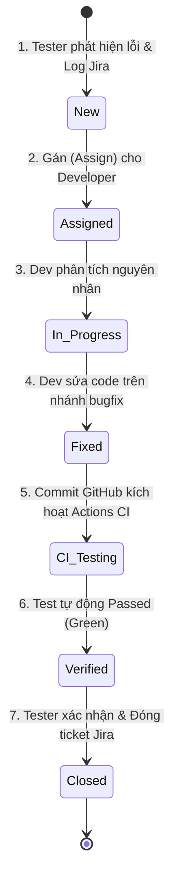

# 🐞 NHẬT KÝ QUẢN LÝ LỖI & THEO DÕI SỬA LỖI (BUG DEFECT TRACKING LOG)

> **Môn học:** Kiểm thử phần mềm (Software Testing) – ĐH Giao thông Vận tải TP.HCM (UTH)  
> **Quy trình STLC:** Vận hành theo mô hình phối hợp Round 1 (Tester phát hiện $\to$ Log Jira $\to$ Dev fix $\to$ CI/CD Run Test $\to$ Merge Main).  
> **Dự án Jira:** `KTWXD` (Website Mua Bán Xe Đạp).

---

## 🔄 1. SƠ ĐỒ LUỒNG XỬ LÝ LỖI (BUG LIFECYCLE WORKFLOW)



---

## 📋 2. BẢNG CHI TIẾT 8 LỖI THỰC TẾ ĐÃ PHÁT HIỆN & KHẮC PHỤC TRONG DỰ ÁN

| Mã Bug Jira | Tiêu Đề Khiếm Khuyết (Bug Summary) | Phân Hệ Lỗi | Mức Độ (Severity) | Người Phát Hiện (Tester) | Người Xử Lý (Dev) | Trạng Thái | Commit / PR Khắc Phục |
|:---:|:---|:---|:---:|:---:|:---:|:---:|:---:|
| **KTWXD-BUG-01** | Lỗi SQL Injection trên thanh tìm kiếm từ khóa | Catalog & Search | **Critical** (Nghiêm trọng) | Lê Thành Nhật | Hoàng Nam Nguyễn | **CLOSED** | Commit `b1aee50` (Dùng Prepared Statement `?`) |
| **KTWXD-BUG-02** | Khóa cứng trạng thái xe khi có đơn hàng thử nghiệm, làm các đơn tiếp theo bị lỗi 400 | Orders & Payment | **Major** (Lớn) | Lê Thành Nhật | Hoàng Nam Nguyễn | **CLOSED** | Commit `341f627` (Tối ưu điều kiện `seller_id !== buyer_id`) |
| **KTWXD-BUG-03** | Khách vãng lai chưa đăng nhập vẫn truy cập được vào URL trang bán xe `/sell.php` | Bảo mật UI (Route Guard) | **Major** (Lớn) | Tuấn Trần | Hoàng Nam Nguyễn | **CLOSED** | Tích hợp `route-guard.js` tự động redirect về `login.php` |
| **KTWXD-BUG-04** | Form đăng ký cho phép mật khẩu dưới 6 ký tự không hiển thị thông báo lỗi cụ thể | Xác thực (Auth) | **Normal** (Vừa) | Lê Thành Nhật | Tuấn Trần | **CLOSED** | Bổ sung BVA validate biên dưới `password.length < 6` |
| **KTWXD-BUG-05** | API xem chi tiết xe `/api/bikes/99999` trả về mã lỗi 500 thay vì 404 Not Found | Catalog API | **Normal** (Vừa) | Nguyễn Thiên Giang | Hoàng Nam Nguyễn | **CLOSED** | Xử lý kiểm tra `rows.length === 0` trả về mã chuẩn HTTP 404 |
| **KTWXD-BUG-06** | File script thực thi `.bat` bị lỗi font chữ có dấu trên CMD Windows | DevOps & Scripts | **Normal** (Vừa) | Lê Thành Nhật | Lê Thành Nhật | **CLOSED** | Commit `af0c5b7` (Chuẩn hóa ASCII & CRLF) |
| **KTWXD-BUG-07** | Pipeline GitHub Actions không tự động thực thi kịch bản kiểm thử hộp trắng trước khi build | CI/CD Pipeline | **Major** (Lớn) | Lê Thành Nhật | Lê Thành Nhật | **CLOSED** | Commit `5d75423` (Tích hợp `whitebox_test.js` vào CI) |
| **KTWXD-BUG-08** | Cho phép người bán tự đặt mua bài đăng xe của chính mình qua API `/api/orders` | Nghiệp vụ Thanh toán | **Critical** (Nghiêm trọng) | Lê Thành Nhật | Hoàng Nam Nguyễn | **CLOSED** | Bổ sung điều kiện chặn `seller_id === buyer_id` |

---

## 📝 3. CHI TIẾT CÁC BƯỚC TÁI HIỆN MẪU (BUG REPORT TEMPLATE)

### Bug mẫu: `KTWXD-BUG-08`: Người bán tự mua bài đăng xe của mình
- **Môi trường thử nghiệm:** Localhost `http://localhost:5000/api` (Postman v11.x)
- **Tiền điều kiện:** Tài khoản `user_id = 1` đã đăng bài bán xe `post_id = 15`.
- **Các bước tái hiện (Steps to Reproduce):**
  1. Đăng nhập bằng tài khoản `user_id = 1` lấy Token.
  2. Gửi request `POST /api/orders` với body:
     ```json
     {
       "post_id": 15,
       "payment_method": "COD",
       "shipping_address": "123 Đường Test"
     }
     ```
  3. Kiểm tra mã phản hồi từ server.
- **Kết quả thực tế trước khi fix:** Server tạo đơn thành công mã 201 Created (Sai nghiệp vụ).
- **Kết quả mong đợi:** Server từ chối và trả về mã lỗi `400 Bad Request` kèm thông báo: *"Bạn không thể mua xe của chính mình"*.
- **Hành động khắc phục:** Thêm logic rẽ nhánh kiểm tra `post.seller_id === buyer_id` trong `paymentController.createOrder` và được bảo vệ bởi **Đường cơ sở Path 4** trong bộ kiểm thử hộp trắng.
