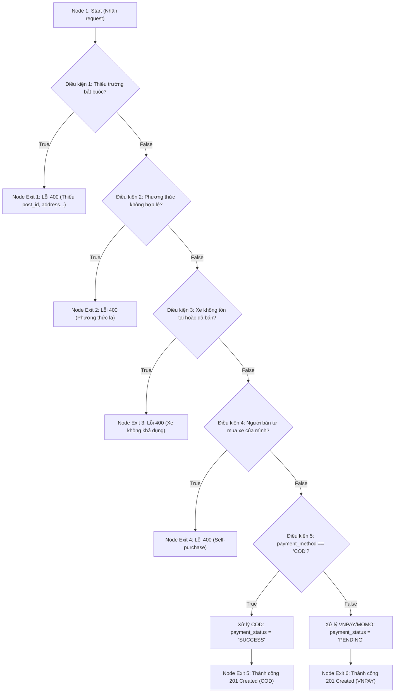
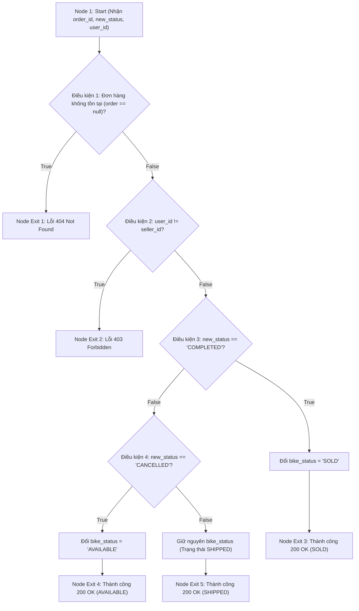

# 🔬 TÀI LIỆU PHÂN TÍCH ĐỒ THỊ DÒNG ĐIỀU KHIỂN (CFG) & BASIS PATH TESTING

> **Dự án:** Website Mua Bán Xe Đạp Thể Thao Cũ  
> **Kỹ thuật:** Kiểm thử Hộp trắng (White-box Testing) – Phân tích Đồ thị Luồng điều khiển (Control Flow Graph - CFG) & Độ phức tạp Cyclomatic (Cyclomatic Complexity).  
> **Module thực thi:** `paymentController.createOrder` và `paymentController.updateOrderStatus`.  
> **Script kiểm thử tự động:** `tests/whitebox_test.js` (11/11 Paths Passed, 100% Branch Coverage).

---

## 1. PHÂN HỆ 1: TẠO ĐƠN HÀNG (`paymentController.createOrder`)

### 1.1. Mã nguồn thuật toán xử lý logic:
```javascript
1:  function validateAndProcessOrder({ buyer_id, post_id, shipping_address, payment_method, post }) {
2:      if (!post_id || !shipping_address || !payment_method) {
3:          return { status: 400, message: 'Thiếu thông tin bắt buộc' };
4:      }
5:      const validMethods = ['COD', 'BANK_TRANSFER', 'VNPAY', 'MOMO'];
6:      if (!validMethods.includes(payment_method)) {
7:          return { status: 400, message: 'Phương thức thanh toán không hợp lệ' };
8:      }
9:      if (!post || (post.status !== 'AVAILABLE' && post.status !== 'PENDING')) {
10:         return { status: 400, message: 'Xe không còn khả dụng hoặc không tồn tại' };
11:     }
12:     if (post.seller_id === buyer_id) {
13:         return { status: 400, message: 'Bạn không thể mua xe của chính mình' };
14:     }
15:     let payment_status = 'PENDING';
16:     if (payment_method === 'COD') {
17:         payment_status = 'SUCCESS';
18:     } else if (['BANK_TRANSFER', 'VNPAY', 'MOMO'].includes(payment_method)) {
19:         payment_status = 'PENDING';
20:     }
21:     return { status: 201, order_id: 101, payment_status };
22: }
```

### 1.2. Sơ đồ Đồ thị Dòng Điều khiển (CFG Mermaid Diagram):



### 1.3. Tính toán Độ phức tạp Cyclomatic:
- Số Nút (Nodes - $N$): **10 nút**
- Số Cạnh (Edges - $E$): **14 cạnh**
- Số Điểm vị từ rẽ nhánh (Predicate Nodes - $P$): **5 điểm** (C1, C2, C3, C4, C5)
- **Công thức Cyclomatic Complexity:**
  $$V(G) = E - N + 2 = 14 - 10 + 2 = 6$$
  Hoặc:
  $$V(G) = P + 1 = 5 + 1 = 6$$

$\implies$ Hệ thống cần chính xác **6 Đường cơ sở độc lập (Basis Paths)** để bao phủ 100% các nhánh rẽ.

### 1.4. Bảng 6 Đường cơ sở độc lập (Basis Paths):
1. **Path 1:** `1 -> C1(True) -> Exit 1` (Lỗi thiếu thông tin bắt buộc $\to$ 400).
2. **Path 2:** `1 -> C1(False) -> C2(True) -> Exit 2` (Phương thức thanh toán lạ $\to$ 400).
3. **Path 3:** `1 -> C1(F) -> C2(F) -> C3(True) -> Exit 3` (Xe không khả dụng $\to$ 400).
4. **Path 4:** `1 -> C1(F) -> C2(F) -> C3(F) -> C4(True) -> Exit 4` (Tự mua xe của mình $\to$ 400).
5. **Path 5:** `1 -> C1(F) -> C2(F) -> C3(F) -> C4(F) -> C5(True) -> Exit 5` (Thành công COD $\to$ 201).
6. **Path 6:** `1 -> C1(F) -> C2(F) -> C3(F) -> C4(F) -> C5(False) -> Exit 6` (Thành công VNPAY $\to$ 201).

---

## 2. PHÂN HỆ 2: CẬP NHẬT TRẠNG THÁI ĐƠN HÀNG (`paymentController.updateOrderStatus`)

### 2.1. Sơ đồ Đồ thị Dòng Điều khiển (CFG Mermaid Diagram):



### 2.2. Tính toán Độ phức tạp Cyclomatic:
- Số Nút (Nodes - $N$): **8 nút**
- Số Cạnh (Edges - $E$): **11 cạnh**
- Số Điểm vị từ rẽ nhánh (Predicate Nodes - $P$): **4 điểm** (MC1, MC2, MC3, MC4)
- **Công thức Cyclomatic Complexity:**
  $$V(G) = E - N + 2 = 11 - 8 + 2 = 5$$
  Hoặc:
  $$V(G) = P + 1 = 4 + 1 = 5$$

$\implies$ Cần chính xác **5 Đường cơ sở độc lập (Basis Paths)** để bao phủ 100% nhánh rẽ.

### 2.3. Bảng 5 Đường cơ sở độc lập:
7. **Path 7:** `M1 -> MC1(True) -> Exit 1` (Không tìm thấy đơn hàng $\to$ 404).
8. **Path 8:** `M1 -> MC1(F) -> MC2(True) -> Exit 2` (Người lạ can thiệp đơn hàng $\to$ 403).
9. **Path 9:** `M1 -> MC1(F) -> MC2(F) -> MC3(True) -> Exit 3` (Hoàn tất giao dịch $\to$ 200, xe chuyển sang SOLD).
10. **Path 10:** `M1 -> MC1(F) -> MC2(F) -> MC3(F) -> MC4(True) -> Exit 4` (Hủy đơn hàng $\to$ 200, hoàn trả xe về AVAILABLE).
11. **Path 11:** `M1 -> MC1(F) -> MC2(F) -> MC3(F) -> MC4(False) -> Exit 5` (Chuyển trạng thái SHIPPED $\to$ 200).

---

## 3. TỔNG HỢP KẾT QUẢ THỰC THI TOÀN BỘ 11 BASIS PATHS

```bash
node tests/whitebox_test.js
```
Kết quả thực thi: **11/11 PATHS PASSED (100% Branch Coverage)**.
Toàn bộ logic nghiệp vụ, xử lý rẽ nhánh và các mã lỗi của hệ thống đã được kiểm chứng tự động hoàn toàn.
