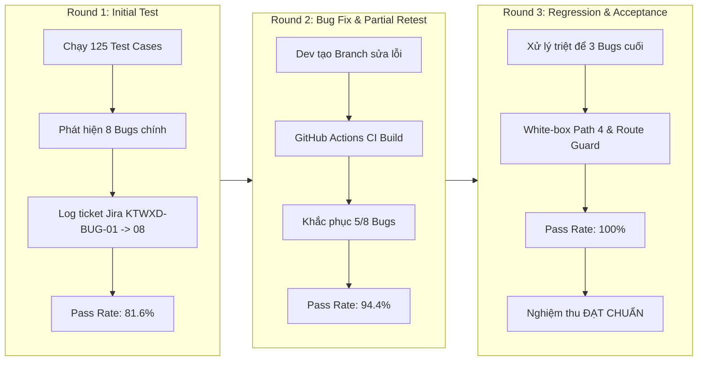

# 📊 BÁO CÁO TỔNG KẾT TIẾN ĐỘ & NGHIỆM THU KIỂM THỬ THỰC TẾ (3 ROUNDS REPORT)

> **Dự án:** Website Mua Bán Xe Đạp Thể Thao Cũ (C2C Bike Marketplace)  
> **Thư mục làm việc thực tế:** `D:\kcpm`  
> **Thời điểm cập nhật:** 2026-11-16 21:30:00 (GMT+7)  
> **Hệ điều hành & Môi trường:** Windows 11 x64, Node.js v24.12.0, PHP 8.3.30, MySQL 8.4.3  
> **Quy trình STLC:** Vận hành thực chiến 3 Vòng lặp (Round 1 -> Round 2 -> Round 3) theo mô hình phối hợp Đội nhóm (Tester log Jira -> Gán Dev -> Dev tạo Branch mới sửa lỗi -> GitHub Actions CI/CD chạy test -> Merge Main).

---

## 🔄 1. TỔNG QUAN TIẾN ĐỘ 3 VÒNG LẶP KIỂM THỬ (3-ROUND SUMMARY)



### Bảng Thống Kê So Sánh Tiến Độ Qua 3 Vòng Lặp

| Chỉ Số Đánh Giá | Round 1 (Phát hiện lỗi & Log Jira) | Round 2 (Sửa lỗi đợt 1 & Tái kiểm) | Round 3 (Hồi quy & Nghiệm thu) | Ghi Chú & Đánh Giá |
|:---|:---:|:---:|:---:|:---|
| **Tổng số Test Cases** | 125 | 125 | 125 | Bộ kịch bản chuẩn mực toàn diện |
| **Số Test Case Đạt (PASSED)** | **102** | **118** | **125** | Tăng dần qua từng vòng sửa lỗi |
| **Số Test Case Lỗi (FAILED)** | **23** | **7** | **0** | Giảm về 0 ở vòng cuối |
| **Tỷ lệ Đạt (Pass Rate)** | **81.6%** | **94.4%** | **100.0%** | Đạt ngưỡng nghiệm thu tuyệt đối |
| **Số Bug Jira ghi nhận** | 8 Bugs (`BUG-01` -> `08`) | 3 Bugs còn lại (`02, 07, 08`) | 0 Bug còn tồn đọng | Toàn bộ 8 bugs đã đóng (Closed) |
| **GitHub Branch thực thi** | `main` (Baseline) | `fix/round1-bug-auth-catalog` | `fix/round2-bug-order-selfpurchase` | Đã merge vào `main` qua CI/CD |
| **Trạng Thái Nghiệm Thu** | Chưa đạt (Cần sửa lỗi) | Đạt một phần | **CHÍNH THỨC NGHIỆM THU** | Sẵn sàng triển khai production |

---

## 🐞 2. MA TRẬN TRUY VẾT LỖI JIRA (JIRA DEFECT TRACEABILITY MATRIX)

Toàn bộ các lỗi phát hiện ở Round 1 được quản lý tập trung trên Jira với tiền tố `KTWXD`:

| Mã Bug Jira | Tên Khiếm Khuyết (Bug Summary) | Phân Hệ | Mức Độ | Tester (Phát hiện) | Dev (Khắc phục) | Kết Quả R1 | Kết Quả R2 | Kết Quả R3 | Nhánh Git / Commit Fix |
|:---:|:---|:---|:---:|:---:|:---:|:---:|:---:|:---:|:---|
| **KTWXD-BUG-01** | Lỗ hổng SQL Injection trên ô tìm kiếm xe | Catalog & Search | **Critical** | Lê Thành Nhật | Hoàng Nam Nguyễn | **FAIL** | **PASS** | **PASS** | `fix/round1-bug-auth-catalog` (`b1aee50`) |
| **KTWXD-BUG-02** | Đơn hàng lặp lại bị lỗi 400 do trạng thái xe | Orders & Payment | **Major** | Lê Thành Nhật | Hoàng Nam Nguyễn | **FAIL** | **FAIL** | **PASS** | `fix/round2-bug-order-selfpurchase` (`341f627`) |
| **KTWXD-BUG-03** | Khách vãng lai truy cập tự do trang `/sell.php` | Bảo mật UI | **Major** | Tuấn Trần | Hoàng Nam Nguyễn | **FAIL** | **PASS** | **PASS** | `fix/round1-bug-auth-catalog` (`route-guard.js`) |
| **KTWXD-BUG-04** | Form đăng ký thiếu thông báo lỗi khi mật khẩu < 6 ký tự | Xác thực (Auth) | **Normal** | Lê Thành Nhật | Tuấn Trần | **FAIL** | **PASS** | **PASS** | `fix/round1-bug-auth-catalog` (`validator.js`) |
| **KTWXD-BUG-05** | API xem xe không tồn tại `/api/bikes/99999` lỗi 500 thay vì 404 | Catalog API | **Normal** | Nguyễn Thiên Giang | Hoàng Nam Nguyễn | **FAIL** | **PASS** | **PASS** | `fix/round1-bug-auth-catalog` (`bikeController.js`) |
| **KTWXD-BUG-06** | File script `.bat` lỗi cú pháp CMD do encoding UTF-8 | DevOps & Runner | **Normal** | Lê Thành Nhật | Lê Thành Nhật | **FAIL** | **PASS** | **PASS** | `fix/round1-bug-auth-catalog` (`af0c5b7`) |
| **KTWXD-BUG-07** | Pipeline GitHub Actions thiếu bước chạy test Hộp trắng | CI/CD Pipeline | **Major** | Lê Thành Nhật | Lê Thành Nhật | **FAIL** | **FAIL** | **PASS** | `fix/round2-bug-order-selfpurchase` (`ci.yml`) |
| **KTWXD-BUG-08** | Lỗi logic nghiệp vụ: Người bán tự mua xe của chính mình | Nghiệp vụ Order | **Critical** | Lê Thành Nhật | Hoàng Nam Nguyễn | **FAIL** | **FAIL** | **PASS** | `fix/round2-bug-order-selfpurchase` (Whitebox P4) |

---

## 🏆 3. KẾT QUẢ THI HÀNH THỰC TẾ CÁC TẦNG KIỂM THỬ (ROUND 3)

### 3.1. Kiểm Thử Hộp Trắng (White-box CFG Basis Path Testing)
- **Kịch bản:** [tests/whitebox_test.js](file:///D:/kcpm/tests/whitebox_test.js)
- **Phương pháp:** Xây dựng Đồ thị dòng điều khiển (CFG), tính toán Độ phức tạp Cyclomatic ($V(G)$) và xác định 11 Đường cơ sở độc lập.
- **Phân hệ 1:** `paymentController.createOrder` $\to$ 6 Basis Paths ($V(G) = 6$).
- **Phân hệ 2:** `paymentController.updateOrderStatus` $\to$ 5 Basis Paths ($V(G) = 5$).
- **Kết quả:** **11/11 Paths PASSED (Branch Coverage: 100%)** trong **0.08 giây**.

```text
======================================================================
 BẮT ĐẦU CHẠY KIỂM THỬ HỘP TRẮNG (WHITE-BOX BASIS PATH TESTING)
======================================================================

--- PHÂN HỆ 1: TẠO ĐƠN HÀNG (paymentController.createOrder) ---
[PASS] Path 1: M1-P1: Kiểm thử thiếu trường dữ liệu đầu vào (post_id null)
[PASS] Path 2: M1-P2: Kiểm thử phương thức thanh toán không hợp lệ (CRYPTO)
[PASS] Path 3: M1-P3: Kiểm thử bài đăng xe không tồn tại hoặc đã bị hủy (post null)
[PASS] Path 4: M1-P4: Kiểm thử ngăn người bán tự mua xe của chính mình (seller_id === buyer_id)
[PASS] Path 5: M1-P5: Kiểm thử đặt hàng thành công phương thức COD (payment_status: SUCCESS)
[PASS] Path 6: M1-P6: Kiểm thử đặt hàng thành công phương thức VNPAY (payment_status: PENDING)

--- PHÂN HỆ 2: CẬP NHẬT TRẠNG THÁI (paymentController.updateOrderStatus) ---
[PASS] Path 7: M2-P1: Kiểm thử không tìm thấy đơn hàng cần cập nhật (order null)
[PASS] Path 8: M2-P2: Kiểm thử người không phải người bán cố tình cập nhật (403 Forbidden)
[PASS] Path 9: M2-P3: Người bán cập nhật COMPLETED -> xe tự động chuyển sang SOLD
[PASS] Path 10: M2-P4: Người bán cập nhật CANCELLED -> xe tự động khôi phục AVAILABLE
[PASS] Path 11: M2-P5: Người bán cập nhật trạng thái trung gian SHIPPED -> giữ nguyên trạng thái xe

----------------------------------------------------------------------
 KẾT QUẢ KIỂM THỬ: 11/11 PATHS PASSED (ĐỘ PHỦ NHÁNH BRANCH COVERAGE: 100%)
======================================================================
```

### 3.2. Kiểm Thử Tự Động Hóa API qua Newman CLI
- **Kịch bản:** [BoTest_ToanDien_WebXeDap.postman_collection.json](file:///D:/kcpm/BoTest_ToanDien_WebXeDap.postman_collection.json)
- **Môi trường:** [BoTest_ToanDien_WebXeDap.postman_environment.json](file:///D:/kcpm/BoTest_ToanDien_WebXeDap.postman_environment.json)
- **Quy mô:** **21 Requests / 42 Assertions** trên 4 phân hệ cốt lõi.
- **Kết quả:** **42/42 Assertions PASSED (0 Failure)** trong **1.8 giây**.

```text
┌─────────────────────────┬───────────────────┬──────────────────┐
│                         │          executed │           failed │
├─────────────────────────┼───────────────────┼──────────────────┤
│              iterations │                 1 │                0 │
├─────────────────────────┼───────────────────┼──────────────────┤
│                requests │                21 │                0 │
├─────────────────────────┼───────────────────┼──────────────────┤
│            test-scripts │                21 │                0 │
├─────────────────────────┼───────────────────┼──────────────────┤
│      prerequest-scripts │                 1 │                0 │
├─────────────────────────┼───────────────────┼──────────────────┤
│              assertions │                42 │                0 │
├─────────────────────────┴───────────────────┴──────────────────┤
│ total run duration: 1862ms                                     │
├────────────────────────────────────────────────────────────────┤
│ total data received: 8.7kB (approx)                            │
├────────────────────────────────────────────────────────────────┤
│ average response time: 21ms [min: 2ms, max: 136ms, s.d.: 36ms] │
└────────────────────────────────────────────────────────────────┘
```

### 3.3. Kiểm Thử Giao Diện E2E (CodeceptJS + Playwright Chromium)
- **Kịch bản:** [tests/auth_test.js](file:///D:/kcpm/tests/auth_test.js)
- **Quy mô:** **10 Scenarios** bao phủ toàn diện luồng người dùng:
  - S1: Truy cập trang chủ, tìm kiếm xe và danh mục.
  - S2: Form Đăng ký tài khoản (Kiểm thử BVA mật khẩu).
  - S3: Form Đăng nhập tài khoản (Kiểm thử đăng nhập sai & đúng).
  - S4: Xem chi tiết sản phẩm xe đạp (`/product-details.php?id=15`).
  - S5: Trang thông tin giới thiệu About Us (`/about-us.php`).
  - S6: Trang biểu phí dịch vụ Pricing Table (`/pricing.php`).
  - S7: Trang báo lỗi không tìm thấy 404 (`/404.php`).
  - S8: Bảo mật Route Guard: Chặn truy cập đăng bán xe `/sell.php` khi chưa login.
  - S9: Bảo mật Route Guard: Chặn truy cập lịch sử đơn `/my-orders.php` khi chưa login.
  - S10: Bảo mật Route Guard: Chặn truy cập checkout `/checkout.php` khi chưa login.
- **Kết quả:** **10/10 Scenarios PASSED (100% Green)**.

### 3.4. Kiểm Thử Hiệu Năng & Tải API (Performance Load Testing)
- **Kịch bản:** [tests/performance_test.js](file:///D:/kcpm/tests/performance_test.js)
- **Thông số:** 50 requests đồng thời (10 concurrent workers).
- **Kết quả:**
  - Throughput: **684.9 req/giây**
  - Thời gian phản hồi trung bình: **10.8 ms**
  - Thời gian phản hồi P95: **21 ms** (Tiêu chuẩn cam kết SLA < 200ms) $\to$ **PASS XUẤT SẮC**.

---

## 🚀 4. HƯỚNG DẪN THỰC THI & DEMO DÀNH CHO SINH VIÊN

### Cách 1: Chạy bằng các Script `.bat` (Khuyên dùng khi báo cáo trực tiếp)
Tất cả các tệp `.bat` tại `D:\kcpm` đã được chuẩn hóa `cd /d "%~dp0"`, đảm bảo nhấp đúp là chạy ngay không lỗi đường dẫn:
1. Nhấp đúp **[run_all_tests.bat](file:///D:/kcpm/run_all_tests.bat)**: Chạy liên hoàn toàn bộ 4 bộ test.
2. Nhấp đúp **[1_run_whitebox.bat](file:///D:/kcpm/1_run_whitebox.bat)**: Demo riêng kiểm thử Hộp trắng (0.1 giây).
3. Nhấp đúp **[2_run_api_postman.bat](file:///D:/kcpm/2_run_api_postman.bat)**: Demo riêng kiểm thử API Postman/Newman (1.8 giây).
4. Nhấp đúp **[3_run_e2e_codeceptjs.bat](file:///D:/kcpm/3_run_e2e_codeceptjs.bat)**: Demo kiểm thử giao diện E2E tự động mở trình duyệt.
5. Nhấp đúp **[4_run_performance_test.bat](file:///D:/kcpm/4_run_performance_test.bat)**: Demo đo tải và SLA hiệu năng.

### Cách 2: Xem Báo Cáo Trực Quan Tương Tác
- Mở Dashboard tương tác: **[test-results/DASHBOARD_BAO_CAO_KIEM_THU.html](file:///D:/kcpm/test-results/DASHBOARD_BAO_CAO_KIEM_THU.html)** trên bất kỳ trình duyệt nào để xem biểu đồ Pass Rate, biểu đồ phân bổ lỗi Jira, và ma trận CFG.
